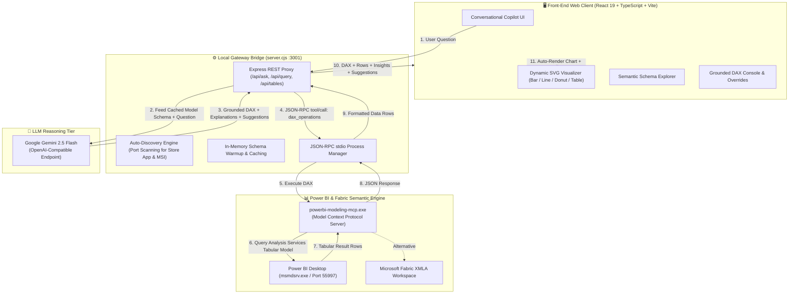
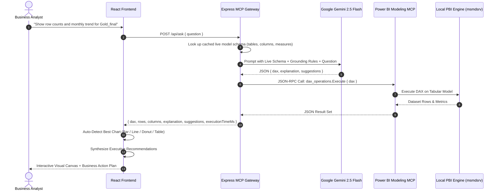

# Power BI MCP AI Analyst ⚡📊

[](https://react.dev/)
[](https://www.typescriptlang.org/)
[](https://vitejs.dev/)
[](https://ai.google.dev/)
[](https://github.com/modelcontextprotocol)
[](https://vercel.com/)

An autonomous, model-agnostic **Generative AI Business Intelligence Analyst** for Microsoft Power BI and Fabric.

Connect your open Power BI Desktop files or Microsoft Fabric XMLA models, ask business questions in natural language, and let Google Gemini formulate mathematically grounded DAX queries, execute them via the **Power BI Modeling Model Context Protocol (MCP)**, and dynamically render interactive SVG visualizations and executive narratives.

---

## 🏛️ System Architecture




---

## 🔄 End-to-End Query Execution Pipeline



---

## ✨ Key Features

- **Dynamic & Model-Agnostic**: Works with **ANY** Power BI model (Sales, Demand Forecasting, Cloud, Finance, HR, Inventory, Marketing, etc.). No hardcoded tables, columns, or metrics.
- **Port Auto-Discovery**: Automatically scans local Analysis Services ports (`msmdsrv.port.txt` in Store App and standard MSI paths) and connects to running Power BI Desktop instances in one click.
- **Strict Schema Grounding**: Gemini is provided the exact tables, column data types, and measures from your live model, eliminating hallucinations.
- **Grounded DAX Execution**: Formulates valid DAX queries using `SUMMARIZECOLUMNS`, `TOPN`, `FILTER`, `EVALUATE`, and `DEFINE` variables.
- **Interactive SVG Visualizer**:
  - Auto-selects Bar, Line, Donut, or Table layouts based on data geometry.
  - Interactive tooltips, data labels, and percentage formatting.
  - Full-screen modal mode with integrated search grid.
- **Live Schema Explorer**: Interactive table-by-table schema browser revealing field data types and column counts.
- **Advanced Developer Console**: Run custom DAX syntax overrides directly with execution timing in milliseconds.
- **Contextual Suggestions**: Gemini dynamically generates intelligent follow-up questions tailored specifically to the columns in the active dataset.

---

## 📋 Prerequisites

1. **Operating System**: Windows 10/11 (for local Power BI Desktop connectivity).
2. **Node.js**: v18.0.0 or higher.
3. **Power BI Desktop**: Any active `.pbix` file opened on your machine.
4. **Power BI Modeling MCP Executable**: `powerbi-modeling-mcp.exe` (v0.1.9+).
5. **Google Gemini API Key**: Free API key from [Google AI Studio](https://aistudio.google.com/).

---

## 🚀 Quick Start Guide

### 1. Clone & Install Dependencies

```bash
git clone https://github.com/<your-username>/powerbi-mcp-analyst.git
cd powerbi-mcp-analyst
npm install
```

### 2. Configure Environment Variables

Create a `.env` file in the project root:

```env
# Google Gemini API Key from Google AI Studio
GEMINI_API_KEY=your_gemini_api_key_here

# Recommended Gemini Model (gemini-2.5-flash)
GEMINI_MODEL=gemini-2.5-flash

# Backend Proxy Port
PORT=3001
```

### 3. Verify Power BI Modeling MCP Path

In `server.cjs` (line ~12), verify the path to your `powerbi-modeling-mcp.exe`:

```javascript
const MCP_PATH = process.env.MCP_PATH || 'C:\\Users\\<YourUsername>\\Downloads\\powerbi-modeling-mcp-win-x64\\powerbi-modeling-mcp.exe';
```

*(You can also set `MCP_PATH` in your `.env` file).*

### 4. Run the Project

#### Step A: Start the Express MCP Gateway
```bash
node server.cjs
```
*The server will scan for running Power BI Desktop instances, connect to the local database port, and cache the model schema.*

#### Step B: Start the Vite Frontend (in a separate terminal)
```bash
npm run dev
```
Open **[http://localhost:5173](http://localhost:5173)** in your browser.

---

## 🌐 Deploying to Vercel

The frontend is fully configured with [vercel.json](file:///c:/Users/harsh/Desktop/powerbi-mcp-analyst/vercel.json) for 1-click deployment.

### Architecture Note on Cloud Deployment
Because Power BI Desktop runs locally on your PC, cloud-hosted web apps on Vercel cannot reach your laptop's local ports (`localhost:3001` or `localhost:55997`) without an HTTPS tunnel.

### Option A: Deploy Frontend with a Secure Tunnel

1. **Expose your local gateway via Cloudflare Tunnel or ngrok**:
   ```bash
   npx ngrok http 3001
   ```
   *Copy your generated URL (e.g. `https://your-subdomain.ngrok-free.app`).*

2. **Deploy to Vercel**:
   ```bash
   npx vercel
   ```

3. **Set the Environment Variable in Vercel**:
   - In Vercel Project Settings → **Environment Variables**:
     ```
     VITE_API_URL=https://your-subdomain.ngrok-free.app
     ```
   - Redeploy (`npx vercel --prod`).

### Option B: Deploy via GitHub

1. Push your repository to GitHub:
   ```bash
   git init
   git add .
   git commit -m "feat: Power BI MCP Analyst"
   git branch -M main
   git remote add origin https://github.com/<your-username>/powerbi-mcp-analyst.git
   git push -u origin main
   ```
2. Import the project in [vercel.com/new](https://vercel.com/new).
3. Vercel automatically selects the **Vite** preset and uses `dist/`.

---

## 📂 Project Directory Structure

```text
powerbi-mcp-analyst/
├── public/
│   ├── architecture-diagram.svg   # Scalable visual system architecture
│   └── favicon.svg
├── src/
│   ├── assets/                    # Styling & icons
│   ├── db/
│   │   ├── daxEngine.ts           # Live DAX query execution bridge
│   │   └── mockData.ts            # Minimal fallback definitions
│   ├── services/
│   │   ├── daxGenerator.ts        # Statistical insight & chart type detection
│   │   └── llmService.ts          # AI API communication client
│   ├── App.tsx                    # Main interactive UI canvas & copilot
│   ├── config.ts                  # Dynamic API gateway configuration
│   ├── index.css                  # Modern dark glassmorphism theme
│   └── main.tsx                   # React root entrypoint
├── server.cjs                     # Express MCP Gateway + Gemini DAX Generator
├── vercel.json                    # Vercel deployment & SPA routing rules
├── vite.config.ts                 # Vite bundler configuration
├── package.json                   # Project scripts and dependencies
└── README.md                      # Comprehensive documentation
```

---

## 🛠️ API Gateway Endpoints

| Method | Endpoint | Description |
|---|---|---|
| `GET` | `/api/status` | Current bridge connection state and active model name |
| `GET` | `/api/instances` | Discovered local Power BI Desktop instances and ports |
| `POST` | `/api/connect-local` | Connects gateway to a local Power BI Desktop port |
| `POST` | `/api/connect-fabric` | Connects gateway to a Microsoft Fabric XMLA workspace |
| `GET` | `/api/tables` | Lists all tables in the active semantic model |
| `GET` | `/api/columns?tableName=...` | Lists columns and data types for a table |
| `GET` | `/api/schema` | Returns full cached schema (tables, columns, measures) |
| `POST` | `/api/query` | Executes arbitrary DAX query directly via MCP |
| `POST` | `/api/ask` | Natural language question → Gemini DAX formulation → MCP execution → Result payload |

---

## 💡 Example Queries to Try

- *"Show total row counts and records across all tables"*
- *"What is the monthly forecast trend over the next 12 months?"*
- *"Show top 10 categories ranked by total usage or cost"*
- *"Compare values across different regions in a donut chart"*
- *"Show distribution of services by storage capacity"*

---

## 📄 License

MIT License. Designed and engineered for high-performance Power BI automation using the Model Context Protocol.
