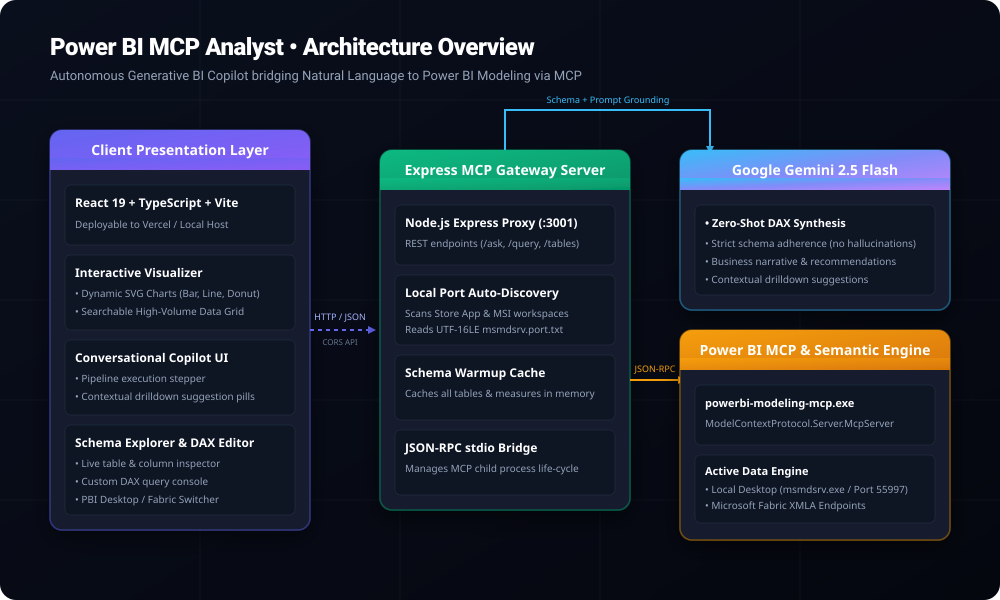
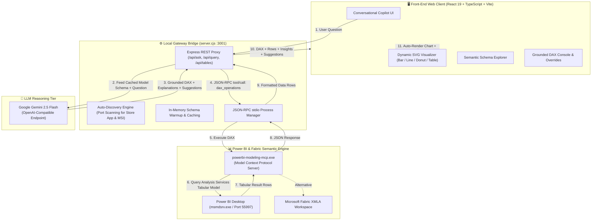
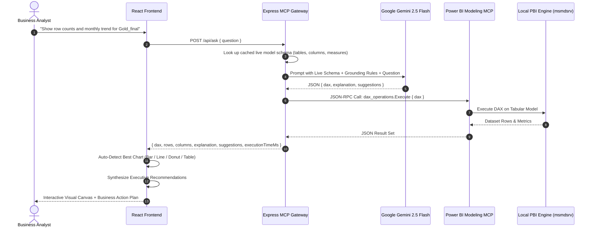

# Power BI MCP AI Analyst ⚡📊

[](https://react.dev/)
[](https://www.typescriptlang.org/)
[](https://vitejs.dev/)
[](https://ai.google.dev/)
[](https://github.com/modelcontextprotocol)
[](https://power-bi-ai-analyst.vercel.app)

An autonomous, model-agnostic **Generative AI Business Intelligence Analyst** for Microsoft Power BI and Fabric.

🔗 **Live Application**: [https://power-bi-ai-analyst.vercel.app](https://power-bi-ai-analyst.vercel.app)

Connect your open Power BI Desktop files or Microsoft Fabric XMLA models, ask business questions in natural language, and let Google Gemini formulate mathematically grounded DAX queries, execute them via the **Power BI Modeling Model Context Protocol (MCP)**, and dynamically render interactive SVG visualizations and executive narratives.

---

## 🏛️ System Architecture





---

## 🔄 End-to-End Query Execution Pipeline



---

## ✨ Key Features

- **📁 PBIX File Studio & Direct Upload**: Drag & drop any `.pbix` or `.pbit` report file directly into the app. Automatically unzips and extracts the semantic data model, DAX measures with exact formulas, relationships, and report canvas pages for deep Copilot analysis — even without Power BI Desktop installed!
- **Dynamic & Model-Agnostic**: Works with **ANY** Power BI model (Sales, Demand Forecasting, Cloud, Finance, HR, Inventory, Marketing, etc.). No hardcoded tables, columns, or metrics.
- **Port Auto-Discovery**: Automatically scans local Analysis Services ports (`msmdsrv.port.txt` in Store App and standard MSI paths) and connects to running Power BI Desktop instances in one click.
- **Strict Schema Grounding**: Gemini is provided the exact tables, column data types, and measures from your live model, eliminating hallucinations.
- **Grounded DAX Execution**: Formulates valid DAX queries using `SUMMARIZECOLUMNS`, `TOPN`, `FILTER`, `EVALUATE`, and `DEFINE` variables.
- **Interactive SVG Visualizer**:
  - Auto-selects Bar, Line, Donut, or Table layouts based on data geometry.
  - Interactive tooltips, data labels, and percentage formatting.
  - Full-screen modal mode with integrated search grid.
- **Live Schema Explorer**: Interactive table-by-table schema browser revealing field data types and column counts.
- **Advanced Developer Console**: Run custom DAX syntax overrides directly with execution timing in milliseconds.
- **Contextual Suggestions**: Gemini dynamically generates intelligent follow-up questions tailored specifically to the columns in the active dataset.

---

## 👥 How Anyone Can Use This Deployed App

The application is deployed live at: **[https://power-bi-ai-analyst.vercel.app](https://power-bi-ai-analyst.vercel.app)**

Depending on your goal, there are **4 distinct ways** anyone can use this app:

---

### 🌟 Scenario 1: Quick Demo & Exploration (Zero Setup Required)
> **Best for:** Evaluators, recruiters, clients, and teammates who want an immediate hands-on test drive without installing anything.

When the host system is active, the deployed web app is already bridged to a live semantic model.

1. **Open the web app**: Navigate to [https://power-bi-ai-analyst.vercel.app](https://power-bi-ai-analyst.vercel.app).
2. **Check Connection**: Look at the top navigation bar. If it shows **`Live Connected`**, you are ready to query!
3. **Ask Any Business Question**: Type in the copilot chat on the right, or click any prompt pill:
   - *"Show total row counts and records across all tables"*
   - *"What is the monthly forecast trend?"*
   - *"Top 10 categories ranked by usage"*
4. **Explore the Results**:
   - The AI writes grounded DAX in real-time, queries the tabular model, and returns verified rows.
   - The frontend automatically picks the ideal visualization (Interactive Bar Chart, Line Graph, Donut Chart, or Data Grid).
   - Use the **Schema Explorer** in the left sidebar to inspect table structures, columns, and data types.

---

### 📁 Scenario 2: Add / Upload a `.pbix` File Directly (Instant In-Browser & Copilot Analysis)
> **Best for:** Anyone with a `.pbix` or `.pbit` file who wants instant schema extraction, DAX measure inspection, report canvas breakdown, and AI Q&A — **no Power BI Desktop installation required**!

1. Open [https://power-bi-ai-analyst.vercel.app](https://power-bi-ai-analyst.vercel.app) (on **Mac, Windows, iPad, or Linux**).
2. Click **PBIX File Studio** in the left sidebar (or the **Add .pbix File** button in the header).
3. **Drag & drop** your `.pbix` or `.pbit` file into the upload zone.
4. The built-in extraction engine unzips the archive in memory and extracts:
   - **All DAX Measures** with complete mathematical formulas and logic
   - **All Model Tables & Columns** with data types and relationships
   - **All Report Canvas Pages** and individual chart/matrix visual containers
5. **Ask Copilot anything about the file**:
   - *"Summarize the key metrics and measures in this report"*
   - *"Explain the calculation logic and performance of measure [Margin %]"*
   - *"Audit the relationships between 'Sales' and 'Customers'"*
   - *"Suggest 5 new DAX measures to calculate performance for this dataset"*
   - *"Review the visuals on Page 1 and recommend improvements"*

---

### 💻 Scenario 3: Connect to YOUR OWN Power BI Desktop File (`.pbix`) via Live Gateway
> **Best for:** Data analysts and team members who want to run live DAX queries against their active in-memory `.pbix` reports using this AI frontend.

Because Power BI Desktop stores data in a local in-memory database (`msmdsrv.exe`) on your Windows PC, browsers running on the public cloud cannot reach your private `localhost` directly without a secure HTTPS bridge. 

Follow these **3 quick steps** to connect the web app to your own machine:

#### Step 1: Open Power BI Desktop
Open any `.pbix` file on your Windows computer. Keep Power BI Desktop open.

#### Step 2: Start Your Local MCP Gateway & Tunnel
Clone or download this repository on your PC, then in terminal run:
```bash
# 1. Install dependencies
npm install

# 2. Start the local bridge (it auto-detects your open Power BI Desktop port)
node server.cjs
```

In a second terminal, expose your local bridge (`http://localhost:3001`) via a free tunnel:

* **Option A — Cloudflare Tunnel (Recommended: No signup, fastest):**
  ```bash
  # Download cloudflared or run via npx:
  npx --yes untun tunnel http://localhost:3001
  # OR if you have cloudflared.exe:
  .\cloudflared.exe tunnel --url http://localhost:3001
  ```
  *Copy the generated `https://*.trycloudflare.com` URL.*

* **Option B — ngrok:**
  ```bash
  npx ngrok http 3001
  ```
  *Copy the generated `https://*.ngrok-free.app` URL.*

* **Option C — localtunnel:**
  ```bash
  npx localtunnel --port 3001
  ```

#### Step 3: Paste Your Tunnel URL in the Web App
1. Open [https://power-bi-ai-analyst.vercel.app](https://power-bi-ai-analyst.vercel.app).
2. In the left navigation, click **Connection Settings**.
3. Under **MCP Gateway Endpoint URL**, replace `http://localhost:3001` with your HTTPS tunnel URL (e.g. `https://xxxx.trycloudflare.com`).
4. Click **Save & Connect**.

🎉 **You're connected!** The web app now sends your natural language questions directly to your own Power BI Desktop file, executes DAX against your private dataset, and displays your insights! *(Your tunnel URL is saved in your browser's `localStorage` and is never shared with anyone else).*

---

### ☁️ Scenario 4: 100% Cloud / Enterprise (Microsoft Fabric & Power BI XMLA)
> **Best for:** Enterprise teams using Power BI Service (Premium / Fabric) who want to query cloud semantic models without running any local software.

1. Open [https://power-bi-ai-analyst.vercel.app](https://power-bi-ai-analyst.vercel.app) on **any device** (Windows, Mac, iPad, Linux, smartphone).
2. Go to **Connection Settings** in the sidebar.
3. Switch to **Option B: Microsoft Fabric XMLA Endpoint**.
4. Fill in:
   - **Workspace Connection**: `powerbi://api.powerbi.com/v1.0/myorg/YourWorkspaceName`
   - **Semantic Model / Dataset Name**: `YourDatasetName`
5. Click **Connect to Fabric Model**.
6. Query live enterprise datasets with zero local software or desktop dependencies.

---

### 📊 Summary Comparison

| Feature / Scenario | 🌟 Scenario 1: Host Demo | 📁 Scenario 2: Add `.pbix` File | 💻 Scenario 3: Local Live `.pbix` | ☁️ Scenario 4: Cloud Fabric XMLA |
|---|---|---|---|---|
| **Local Software Needed** | ❌ None (0 sec) | ❌ None (Drag & drop file) | ⚙️ Run `server.cjs` + Tunnel | ❌ None |
| **User Device** | Any (PC, Mac, Mobile) | Any (PC, Mac, Mobile) | Windows (where PBI runs) | Any (PC, Mac, Mobile) |
| **Dataset Source** | Host's active model | Uploaded `.pbix` / `.pbit` | Your private `.pbix` file | Power BI Service / Fabric |
| **Analysis Type** | Live DAX query rows | Schema, DAX logic, AI Q&A | Live row-level DAX queries | Live cloud XMLA DAX queries |
| **Privacy / Isolation** | Shared demo model | 100% in-browser memory | 100% Local to your PC | Microsoft Entra / Tenant Cloud |

---

## 📋 Prerequisites

1. **Operating System**: Windows 10/11 (for local Power BI Desktop connectivity).
2. **Node.js**: v18.0.0 or higher.
3. **Power BI Desktop**: Any active `.pbix` file opened on your machine.
4. **Power BI Modeling MCP Executable**: `powerbi-modeling-mcp.exe` (v0.1.9+).
5. **Google Gemini API Key**: Free API key from [Google AI Studio](https://aistudio.google.com/).

---

## 🚀 Quick Start Guide

### 1. Clone & Install Dependencies

```bash
git clone https://github.com/Harshal2605-M/Power-BI-AI-Analyst.git
cd powerbi-mcp-analyst
npm install
```

### 2. Configure Environment Variables

Create a `.env` file in the project root:

```env
# Google Gemini API Key from Google AI Studio
GEMINI_API_KEY=your_gemini_api_key_here

# Recommended Gemini Model (gemini-3.5-flash-lite or gemini-2.5-flash)
GEMINI_MODEL=gemini-3.5-flash-lite

# Backend Proxy Port
PORT=3001
```

### 3. Verify Power BI Modeling MCP Path

In `server.cjs` (line ~12), verify the path to your `powerbi-modeling-mcp.exe`:

```javascript
const MCP_PATH = process.env.MCP_PATH || 'C:\\Users\\<YourUsername>\\Downloads\\powerbi-modeling-mcp-win-x64\\powerbi-modeling-mcp.exe';
```

*(You can also set `MCP_PATH` in your `.env` file).*

### 4. Run the Project

#### Step A: Start the Express MCP Gateway
```bash
node server.cjs
```
*The server will scan for running Power BI Desktop instances, connect to the local database port, and cache the model schema.*

#### Step B: Start the Vite Frontend (in a separate terminal)
```bash
npm run dev
```
Open **[http://localhost:5173](http://localhost:5173)** in your browser.

---

## 🌐 Deploying to Vercel

The frontend is fully configured with [vercel.json](file:///c:/Users/harsh/Desktop/powerbi-mcp-analyst/vercel.json) for 1-click deployment.

### Architecture Note on Cloud Deployment
Because Power BI Desktop runs locally on your PC, cloud-hosted web apps on Vercel cannot reach your laptop's local ports (`localhost:3001` or `localhost:55997`) without an HTTPS tunnel.

### Option A: Deploy Frontend with a Secure Tunnel

1. **Expose your local gateway via Cloudflare Tunnel or ngrok**:
   ```bash
   npx ngrok http 3001
   ```
   *Copy your generated URL (e.g. `https://your-subdomain.ngrok-free.app`).*

2. **Deploy to Vercel**:
   ```bash
   npx vercel
   ```

3. **Set the Environment Variable in Vercel**:
   - In Vercel Project Settings → **Environment Variables**:
     ```
     VITE_API_URL=https://your-subdomain.ngrok-free.app
     ```
   - Redeploy (`npx vercel --prod`).

### Option B: Deploy via GitHub

1. Push your repository to GitHub:
   ```bash
   git init
   git add .
   git commit -m "feat: Power BI MCP Analyst"
   git branch -M main
   git remote add origin https://github.com/Harshal2605-M/Power-BI-AI-Analyst.git
   git push -u origin main
   ```
2. Import the project in [vercel.com/new](https://vercel.com/new).
3. Vercel automatically selects the **Vite** preset and uses `dist/`.

---

## 📂 Project Directory Structure

```text
powerbi-mcp-analyst/
├── public/
│   ├── architecture-diagram.svg   # Scalable visual system architecture
│   └── favicon.svg
├── src/
│   ├── assets/                    # Styling & icons
│   ├── db/
│   │   ├── daxEngine.ts           # Live DAX query execution bridge
│   │   └── mockData.ts            # Minimal fallback definitions
│   ├── services/
│   │   ├── daxGenerator.ts        # Statistical insight & chart type detection
│   │   └── llmService.ts          # AI API communication client
│   ├── App.tsx                    # Main interactive UI canvas & copilot
│   ├── config.ts                  # Dynamic API gateway configuration
│   ├── index.css                  # Modern dark glassmorphism theme
│   └── main.tsx                   # React root entrypoint
├── server.cjs                     # Express MCP Gateway + Gemini DAX Generator
├── vercel.json                    # Vercel deployment & SPA routing rules
├── vite.config.ts                 # Vite bundler configuration
├── package.json                   # Project scripts and dependencies
└── README.md                      # Comprehensive documentation
```

---

## 🛠️ API Gateway Endpoints

| Method | Endpoint | Description |
|---|---|---|
| `GET` | `/api/status` | Current bridge connection state and active model name |
| `GET` | `/api/instances` | Discovered local Power BI Desktop instances and ports |
| `POST` | `/api/connect-local` | Connects gateway to a local Power BI Desktop port |
| `POST` | `/api/connect-fabric` | Connects gateway to a Microsoft Fabric XMLA workspace |
| `GET` | `/api/tables` | Lists all tables in the active semantic model |
| `GET` | `/api/columns?tableName=...` | Lists columns and data types for a table |
| `GET` | `/api/schema` | Returns full cached schema (tables, columns, measures) |
| `POST` | `/api/query` | Executes arbitrary DAX query directly via MCP |
| `POST` | `/api/ask` | Natural language question → Gemini DAX formulation → MCP execution → Result payload |

---

## 💡 Example Queries to Try

- *"Show total row counts and records across all tables"*
- *"What is the monthly forecast trend over the next 12 months?"*
- *"Show top 10 categories ranked by total usage or cost"*
- *"Compare values across different regions in a donut chart"*
- *"Show distribution of services by storage capacity"*

---

## 📄 License

MIT License. Designed and engineered for high-performance Power BI automation using the Model Context Protocol.
